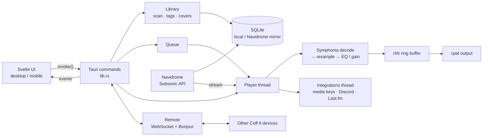

<div align="center">

# ☕ Coff-fi

### *Your music, brewed slow*

[](https://www.rust-lang.org/)
[](https://tauri.app/)
[](https://svelte.dev/)
[](LICENSE)

<!-- TODO: add a screenshot or demo.gif (e.g. assets/demo.gif) -->

</div>

---

## Overview

Coff-fi is a cosy music player for your own library. It plays local files or a
[Navidrome](https://www.navidrome.org/) server through a native Rust audio engine (gapless,
crossfade, 10-band EQ, ReplayGain), shows synced lyrics, and lets any Coff-fi on your network
control any other one, Spotify Connect-style.

One codebase ships a desktop app (macOS, Windows, Linux) and an iPhone app. The UI is Svelte 5
inside a Tauri 2 webview; everything that touches audio, files or the network lives in Rust.

> [!NOTE]
> On iOS a thin Swift layer (`src-tauri/gen/apple/Sources/coff-fi/Native/`) connects the Rust
> engine to the audio session, lock screen, AirPlay, Siri and the Files app. Playback itself
> still runs in Rust.

## Table of Contents

- [Features](#features)
- [Known Limitations](#known-limitations)
- [Toolchain](#toolchain)
- [Build & Run](#build--run)
- [Cross-Platform Builds](#cross-platform-builds)
- [Keyboard Shortcuts](#keyboard-shortcuts)
- [System Architecture](#system-architecture)
- [Source Tree](#source-tree)
- [License](#license)

## Features

| Area | Details |
| :--- | :--- |
| 🎧 Audio engine | Symphonia decoding, rubato sinc resampling to the device rate, cpal output through a lock-free ring buffer. Gapless playback, crossfade, playback speed, output device selection, fade on pause |
| 🎚️ Sound shaping | 10-band peaking EQ (31 Hz to 16 kHz) with preamp, built-in and saved presets; ReplayGain (track / album) with preamp and clip-limited boosts |
| 📚 Library | MP3, FLAC, WAV, OGG, M4A/AAC/ALAC, AIFF, CAF, MKA, WebM. Parallel scan (rayon) into SQLite, tags via lofty, embedded or folder covers (`cover.jpg` first), excluded folders, live file watching on desktop |
| 🗂️ Browsing | Home with smart lists (Recently Played, Recently Added, Most Played, Random Mix, Favorites), albums, artists, folder tree, `Ctrl/Cmd+K` search palette, tag editor, track info |
| 📜 Queue | Shuffle, repeat (off / all / one), reorder, play next, saved queues, sleep timer (minutes or end of track) |
| 🎤 Lyrics | Embedded tags or a sibling `.lrc`, otherwise [LRCLIB](https://lrclib.net). Plain, line-synced and word-synced (enhanced LRC) with background vocals; results cached in SQLite |
| ☁️ Navidrome | Mirrors a Subsonic-API server into its own database so every view works the same; streams on demand. On iOS the playing song plus the next 8 are kept downloaded for flaky connections |
| 📡 Remote control | Each Coff-fi runs a WebSocket server (port `47321`, falls back to a random port) and advertises `_coffi._tcp` over Bonjour. Pick a device and drive its library, queue and playback; connect by address also works |
| 🖥️ Desktop integrations | OS media controls (MPRIS / SMTC / macOS Now Playing via souvlaki), Discord Rich Presence, Last.fm scrobbling |
| 📱 iOS | Dedicated touch UI, lock screen / Dynamic Island Now Playing, AirPlay, background audio, Files-app music folder, Siri + App Intents (play playlist / album / artist / song), haptics, landscape Nightstand view |

## Known Limitations

| Not supported | Why / workaround |
| :--- | :--- |
| Android | No Android project is generated; only desktop and iOS are set up |
| File watching on iOS | iOS has no watcher; the library rescans when the app returns to the foreground |
| Discord Rich Presence on iOS | No Discord IPC on iOS; desktop only |
| Last.fm out of the box | You need your own Last.fm API key and secret, entered in Settings |
| SiriKit voice intents with a free Apple ID | `com.apple.developer.siri` needs a paid team; set `CoffiSiriKit: false` in `project.yml` and drop the entitlement. App Intents keep working |
| iOS below 26.0 | `minimumSystemVersion` is `26.0` |
| Cross-compiling Linux from macOS | Needs a Linux container, VM or CI runner (see [Cross-Platform Builds](#cross-platform-builds)) |

## Toolchain

| Tool | Version | Used for |
| :--- | :--- | :--- |
| Rust (rustup) | stable | Backend, audio engine |
| Node.js + npm | 20+ | Vite, Svelte, Tauri CLI |
| Xcode | 26+ | macOS and iOS builds |
| Tauri prerequisites | see [tauri.app/start/prerequisites](https://tauri.app/start/prerequisites/) | Per-OS system libraries (WebKitGTK on Linux, WebView2 on Windows) |

## Build & Run

```bash
npm install
npm run tauri dev        # desktop app with hot reload (Vite on :1420)
npm run tauri build      # release bundle for the current OS
npm run check            # svelte-check type checking
```

Release bundles land in `src-tauri/target/release/bundle/`.

### iOS

```bash
rustup target add aarch64-apple-ios aarch64-apple-ios-sim
npm run tauri ios dev                 # simulator or a connected iPhone
npm run tauri ios build               # signed build (needs the team in tauri.conf.json)
npm run ipa:unsigned                  # unsigned .ipa for AltStore / SideStore / Sideloadly
```

The unsigned IPA is written to `src-tauri/gen/apple/build/arm64/Coff-fi-unsigned.ipa`.

> [!WARNING]
> No Apple team is committed. Export yours before any iOS build (including `ipa:unsigned`):
> `export APPLE_DEVELOPMENT_TEAM=<your team ID>` (find it in Xcode → Settings → Accounts).

## Cross-Platform Builds

Everything below starts from one Apple Silicon Mac.

| Target | Route from a Mac | Output |
| :--- | :--- | :--- |
| macOS | Native | `.app`, `.dmg` |
| iOS | Native (Xcode) | `.ipa` |
| Windows | Cross-compile with `cargo-xwin` (experimental in Tauri) | NSIS `-setup.exe` (no `.msi`) |
| Linux | Docker / VM, or CI | `.deb`, `.rpm`, `.AppImage` |

<details>
<summary><b>macOS (Intel + Apple Silicon)</b></summary>

```bash
rustup target add x86_64-apple-darwin aarch64-apple-darwin
npm run tauri build -- --target universal-apple-darwin
# -> src-tauri/target/universal-apple-darwin/release/bundle/{macos,dmg}/
```

Unsigned builds run locally; to share them without Gatekeeper warnings, sign and notarize
with a Developer ID (see Tauri's macOS signing guide).

</details>

<details>
<summary><b>iOS</b></summary>

See [Build & Run → iOS](#ios). Building for iOS always requires a Mac with Xcode.

</details>

<details>
<summary><b>Windows (cross-compiled from macOS)</b></summary>

```bash
brew install nsis llvm
export PATH="$(brew --prefix llvm)/bin:$PATH"
rustup target add x86_64-pc-windows-msvc
cargo install --locked cargo-xwin
npm run tauri build -- --runner cargo-xwin --target x86_64-pc-windows-msvc
# -> src-tauri/target/x86_64-pc-windows-msvc/release/bundle/nsis/Coff-fi_0.8.0_x64-setup.exe
```

`cargo-xwin` downloads the Windows SDK and CRT headers on first use (accepting Microsoft's
license). Only the NSIS installer can be produced off Windows; `.msi` needs WiX on Windows.
The installer fetches WebView2 on machines that don't have it.

</details>

<details>
<summary><b>Linux (Docker on macOS)</b></summary>

Tauri can't cross-compile to Linux because it links against the system WebKitGTK, so build
inside a Linux container (Docker Desktop, OrbStack or Colima):

```bash
docker run --rm -it --platform linux/amd64 -v "$PWD":/app -w /app rust:1-bookworm bash
# inside the container:
apt-get update && apt-get install -y libwebkit2gtk-4.1-dev build-essential curl wget file \
  libxdo-dev libssl-dev libayatana-appindicator3-dev librsvg2-dev libasound2-dev libdbus-1-dev
curl -fsSL https://deb.nodesource.com/setup_22.x | bash - && apt-get install -y nodejs
rm -rf node_modules && npm ci
npm run tauri build
# -> src-tauri/target/release/bundle/{deb,rpm,appimage}/
```

`libasound2-dev` is for cpal (ALSA) and `libdbus-1-dev` for MPRIS media controls.
Use `--platform linux/arm64` for ARM Linux; it runs natively on Apple Silicon and is much
faster than emulated `amd64`.

> [!CAUTION]
> The container shares your project folder. `rm -rf node_modules` there deletes your macOS
> `node_modules` too; run `npm install` again on the Mac afterwards. Container builds also go into
> `src-tauri/target`, next to your macOS builds.

</details>

<details>
<summary><b>CI alternative (GitHub Actions)</b></summary>

[`tauri-apps/tauri-action`](https://github.com/tauri-apps/tauri-action) with a
`macos-latest` / `windows-latest` / `ubuntu-22.04` matrix builds native bundles for all three
desktop platforms on push, including `.msi`. Private repositories consume Actions minutes, and
macOS runners count at a higher rate.

</details>

## Keyboard Shortcuts

| Key | Action |
| :--- | :--- |
| <kbd>Space</kbd> | Play / pause |
| <kbd>Ctrl/Cmd</kbd> + <kbd>→</kbd> / <kbd>←</kbd> | Next / previous track |
| <kbd>→</kbd> / <kbd>←</kbd> (full player) | Seek ±5 s |
| <kbd>Ctrl/Cmd</kbd> + <kbd>K</kbd> | Search palette |
| <kbd>Ctrl/Cmd</kbd> + <kbd>,</kbd> | Settings |
| <kbd>Cmd</kbd> + <kbd>[</kbd> / <kbd>Alt</kbd> + <kbd>←</kbd> | Back |
| <kbd>Esc</kbd> | Close the open panel, player or collection |

## System Architecture



<details>
<summary><b>Audio engine</b></summary>

A dedicated player thread owns decoding. It keeps a few seconds decoded ahead of the device,
resampled to the output rate, and pushes interleaved `f32` frames into a lock-free `rtrb` ring
buffer that the realtime cpal callback drains. Volume, pause and flush requests reach the callback
through atomics only, so the audio thread never locks. The next track is pre-buffered for gapless
hand-over or crossfade, and the thread sleeps until the buffer is half drained (longer while the
app is in the background).

</details>

<details>
<summary><b>Two libraries, one schema</b></summary>

Local files and the Navidrome mirror use separate SQLite databases with the same schema.
Navidrome tracks get virtual `navidrome://<id>.<ext>` paths and are streamed on demand, so every
view, search and smart list works unchanged. Settings always live in the local database.

</details>

<details>
<summary><b>Remote control</b></summary>

Every instance starts a WebSocket server and registers it over Bonjour unless sharing is off.
A controlling device forwards library, queue and playback commands (`remote/dispatch.rs`) and
mirrors the target's events, so its UI behaves as if the other device's library were local.

</details>

## Source Tree

```
coff-fi
├── src/                        Svelte 5 frontend
│   ├── main.ts                 picks the desktop or mobile root by platform
│   ├── App.svelte              desktop shell + keyboard shortcuts
│   ├── components/             desktop UI (player, queue, lyrics, search, settings)
│   ├── mobile/                 iOS UI (tab bar, Now Playing, Nightstand, pages)
│   ├── views/                  Home, Directory, Collection
│   └── lib/                    state, IPC wrappers, types, remote state
├── src-tauri/
│   ├── src/
│   │   ├── lib.rs              app state + Tauri commands
│   │   ├── audio/              player thread, decoder, EQ, cpal output
│   │   ├── library/            scanner, SQLite, tags, covers, file watcher
│   │   ├── lyrics/             local / LRCLIB lookup, LRC parser, matching
│   │   ├── remote/             WebSocket server/client, Bonjour, dispatch
│   │   ├── integrations/       media controls, Discord, Last.fm
│   │   ├── navidrome.rs        Subsonic mirror + streaming
│   │   ├── cache.rs            iOS queue download cache
│   │   ├── queue.rs            queue, shuffle, repeat
│   │   ├── settings.rs         persisted settings
│   │   └── native.rs           Rust ↔ Swift bridge (iOS)
│   ├── gen/apple/              Xcode project + Swift native layer
│   ├── capabilities/           Tauri permissions
│   ├── icons/                  app icons
│   └── tauri.conf.json
├── scripts/make-unsigned-ipa.sh
└── assets/                     source icons
```

## License

MIT. See [LICENSE](LICENSE).

---

<div align="center">

*"Put the kettle on. The queue can wait."*

</div>
